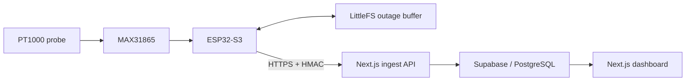

# ULT freezer monitoring

An embedded monitoring system being developed for a 21-freezer research study at the University of Washington. ESP32-S3 sensor nodes send temperature readings to a PostgreSQL backend and a web dashboard. The study will pair temperature records with separate energy measurements to evaluate preventive maintenance.

The project has **$18,500 in combined support**: a $13,500 UW Campus Sustainability Fund award and a $5,000 campus gift contribution. See the [UW project record](https://csf.uw.edu/project/1356-ultra-low-temperature-freezer-optimization-through-sensor-monitoring).

**Status:** Research prototype; deployment and physical validation are in progress. Energy savings have not been established. This system has not been validated as a freezer alarm.

## My role

I'm Enoch Yi, the project manager. My technical work includes the sensor circuits, ESP32 firmware, Supabase backend, and enclosure CAD. I also coordinate the hardware, software, and study work. The dashboard, installation, and research are a team effort.

## How it works



The two-wire PT1000 connects through an Adafruit MAX31865 #3648. Only the probe and lead enter the freezer; the electronics and USB power stay outside. The firmware is configured for 60-second sampling on freezer IDs 1–6 and 900-second sampling on IDs 7–21. Prototype 22 is a separate bench instrument with its own storage.

**Stack:** C++ · Arduino / PlatformIO · ESP32-S3 · TypeScript · Next.js / React · Supabase / PostgreSQL · Python / CadQuery

## Engineering decisions

- **Handle network outages.** A LittleFS queue buffers readings and retries uploads with backoff. Storage is bounded, so retention depends on record size and cadence; the queue cannot guarantee unlimited recovery. See the [firmware](firmware/src/main.cpp).
- **Check device writes.** The [ingest route](web/app/api/ingest/route.ts) verifies HMAC signatures, device identity, timestamps, and payload limits before forwarding readings. Server credentials stay outside the browser and firmware. [Tests](web/app/api/ingest/route.test.ts) exercise those boundaries.
- **Preserve measurement context.** The [database](supabase/schema.sql) keeps measurement and receipt timestamps separate. History queries filter by sensor type and retain min/max values alongside averages, so aggregation does not hide temperature excursions or mix instruments.
- **Make hardware revisions reproducible.** The [CadQuery builder](cad_enclosure/enclosure_pt1000.py) produces editable enclosure geometry, with [geometry tests](cad_enclosure/test_enclosure_geometry.py) and [export checks](cad_enclosure/verify_enclosure_exports.py). Physical fit still needs bench acceptance.

## Validation and remaining work

On October 20, 2026, this review revision passed **24 web/API tests** and **42 offline automation/SQL tests**, using mocks and synthetic fixtures. The SQL checks include an isolated PostgreSQL restore rehearsal. These results establish local software behavior; they do not establish live ingestion, sensor accuracy, or energy savings. See the [QA guide](docs/LOCAL_QA_RUNNER.md) for the wider verification workflow.

Before field acceptance, the project still needs cold-reference checks, enclosure and cable-routing trials, a matched application/database release, and security hardening. Observation IDs can repeat after NVS erase or a board replacement; the [identity decision record](docs/OBSERVATION_IDENTITY_DECISION.md) explains the unresolved data-loss risk.

The supplied database policies allow public temperature reads. Use only data approved for public access. Keep the lab's existing monitoring and alarm procedures in place.

## Explore locally

Use Node.js 24 or newer with npm. Copy [web/.env.example](web/.env.example) to an ignored `web/.env.local` and configure your own test Supabase project. Keep service keys and device secrets server-side; never put them in a `NEXT_PUBLIC_*` variable.

```sh
cd web
npm ci
npm test
npm run typecheck
npm run dev
```

For a firmware build, use PlatformIO from a checkout outside OneDrive:

```sh
cd firmware
pio run -e esp32-s3
```

That command compiles only. Commissioning requires private device configuration and the lab's hardware acceptance procedure. Firmware dependencies are pinned in [platformio.ini](firmware/platformio.ini); web versions are recorded in [package-lock.json](web/package-lock.json).

This is a source review candidate. Automatic Vercel deployment is disabled for this branch; the included replay-index migration and matching ingest route still require coordinated release acceptance.
